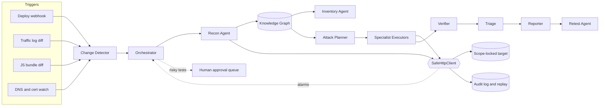

# PROJECT TRIPWIRE
### Agentic Real-Time DAST for B2B Travel Platforms
*TBO Security Hackathon 2026 | Complete blueprint: problem, solution, and build direction*

> **How to use this file.** It is the single source of truth. Sections 1 to 2 define the problem and why we chose it. Sections 3 to 12 define the solution and every quality bar. Section 13 contains the master prompt to paste into the Antigravity Agent Manager (Planning mode), which tells the agent to read this file and build until every benchmark is met honestly.

---

## Table of contents

1. Problem statement
2. Why this problem
3. Our solution: TRIPWIRE
4. Architecture
5. Safety model
6. Tech stack
7. Repository layout
8. The lab target: Voyager
9. Roadmap and gates
10. Benchmarks and honesty rules
11. Frontend and UI specification
12. README specification
13. Build instructions and master prompt
14. Event-day playbook
15. Risk register
16. Definition of done
17. Commit and branch conventions

---

## 1. Problem statement

*Source: TBO Security Hackathon 2026, Participant Pack. Summarised faithfully; the original PDF is authoritative.*

### 1.1 Context

B2B travel platforms change constantly: new APIs, booking and payment changes, supplier integrations and role updates go live every day. Each change can open a vulnerability, and the most damaging ones are business-logic flaws:

- One agency reads another agency's bookings.
- A fare is changed in the request.
- A refund is paid twice.
- A sub-agent quietly gains admin rights.

Most application security testing is still periodic and generic. Scans run on a schedule, treat every endpoint the same, miss business-logic abuse and produce long lists of false positives. By the time a real finding reaches its owner, the code has already moved on.

### 1.2 The challenge

Design and build autonomous security agents that test a live, production-like travel platform in near real time. They must:

- notice what changed,
- understand how the application and its business flows work,
- plan and run targeted attacks safely,
- prove each finding,
- report it to the right owner within minutes of a deploy.

The agents should help decide:

| Decision | Question |
|---|---|
| What to test | What changed since the last run, and what needs testing now? |
| Which attacks | Which attacks make sense for each endpoint, given parameters, roles and business purpose? |
| Real vs noise | Which findings are real and exploitable, and which are noise? |
| Severity | How serious is a finding for this business (bookings, payments, credit, PII, supplier access)? |
| Autonomy | When to proceed, slow down, stop, or hand over to a human? |
| Inventory | Which endpoints are active, which are zombie (live but unused), which are shadow (used but undocumented)? |

Any approach is allowed: LLM agents, classic scanners, rule engines, fuzzers, or hybrids.

### 1.3 The agent loop

| Stage | What the agent does |
|---|---|
| Detect change | Reacts to a deploy, a new or changed endpoint in traffic, new front-end JS bundles, or a new subdomain |
| Learn the app and build inventory | Discovers endpoints and parameters with no documentation: crawls the UI with test accounts at each role, records browser traffic, reads front-end JS for routes, probes for hidden paths. Compares the inferred map against real traffic over a 30 or 90 day window to flag zombie and shadow endpoints |
| Plan attacks | Chooses targeted tests per endpoint instead of spraying every payload |
| Execute safely | Sends scoped, rate-limited requests and backs off if the app shows strain |
| Verify | Confirms each hit with a minimal, clean proof so only real issues survive |
| Triage | Removes duplicates, scores severity in business context, maps each finding to an owner |
| Report | Raises a ticket with evidence, impact, severity, owner and a suggested fix |
| Retest | Reruns the proof after a fix and closes the finding once resolved |

### 1.4 Suggested reference architecture (not mandatory)

- Change triggers: CI/CD deploy webhooks, API gateway or load balancer logs, front-end bundle diffs, DNS and certificate watchers.
- Orchestrator agent: decides what to test and in what order, and pauses everything when the safety layer raises an alarm.
- Recon agent and application knowledge graph: stored map of endpoints, parameters, roles and flows (search, hold, book, pay, cancel).
- Inventory agent: compares the graph against 30 to 90 days of traffic logs and labels each endpoint active, zombie or shadow.
- Attack planner: reasons over the graph to pick targeted tests.
- Specialist executor agents: one per vulnerability class, optionally wrapping ZAP, Nuclei or sqlmap, with reasoning for business-logic tests.
- Safety layer: scope allowlist, rate limiting, health monitoring, test-credential vault, audit log of every request.
- Verifier, triage, reporter and retest agents.
- Human reviewer: approves risky tests and checks high-severity findings before escalation.

### 1.5 Vulnerability classes in scope

| Class | Examples |
|---|---|
| Access control | IDOR on booking, invoice or traveller IDs; cross-agency data access; sub-agent to admin escalation |
| Business logic | Fare or markup tampering, coupon reuse, cancel-rebook refund abuse, skipped payment steps, negative quantities |
| Authentication and sessions | Weak password reset, token reuse, session fixation, JWT flaws, missing step-up auth |
| Injection | SQL, NoSQL, command, template and header injection in search, filters and supplier callbacks |
| API hygiene | Unauthenticated new endpoints, mass assignment, excessive data in responses, missing rate limits |
| Data exposure | Passport, card or contact data in responses, error messages, logs or debug endpoints |
| Server-side risks | SSRF via supplier or webhook URLs, insecure file upload, open redirects |
| Zombie and shadow APIs | Old versions still live (`/v1/` after `/v3/`), retired partner endpoints, debug routes in production, endpoints from decommissioned app builds, services on forgotten hosts |

### 1.6 Additional requirement: zombie and shadow API inventory

This is secondary to the core objective but scored. Useful techniques: guessing older versions and naming patterns (`/v1/`, `/old/`, `/internal/`, `/test/`, `/beta/`), reading old JS bundles and mobile builds for routes no longer called, public archives such as the Wayback Machine, gateway route configs for paths with no matching traffic, and old subdomains from DNS history and certificate transparency.

For every zombie or shadow endpoint the report must state:

- when it last saw real traffic,
- whether it is reachable without auth,
- what data it exposes,
- which vulnerabilities it has compared with its current version,
- the likely owner,
- a recommendation: decommission, restrict, or bring up to date.

Bonus points are offered for generating an OpenAPI spec as a by-product.

### 1.7 Environment and inputs

TBO provides a production-like staging environment with selected travel flows, never real customer data. No OpenAPI or other documentation is provided. Possible inputs:

- running web portal and mobile or partner APIs,
- test accounts at several roles across at least two agencies,
- sample recorded traffic (HAR or proxy logs),
- gateway and load balancer logs for the last 30 to 90 days,
- CI/CD deploy events and release notes,
- DNS records, certificates and service fingerprints,
- application and access logs,
- asset ownership data and past findings.

Planted vulnerabilities exist but not all are documented. New changes will be deployed during the event to see whose agents catch them first.

### 1.8 Rules of engagement (breaking these disqualifies a submission)

1. Stay within the approved target list and stop at anything outside it.
2. Use only the provided test accounts and synthetic data.
3. Rate-limit yourself; never run denial-of-service or destructive tests.
4. Prove findings with minimum evidence, without bulk data extraction or keeping access.
5. Log every request so reviewers can replay what the agent did.

### 1.9 Judging weights

| Criterion | Weight |
|---|---|
| Valid findings and severity | 30% |
| Precision and noise control | 20% |
| Safety and scope discipline | 20% |
| Speed after change | 10% |
| Report quality and actionability | 10% |
| Discovery and API inventory | 10% |

What a strong submission shows: speed, depth (business-logic flaws that scanners miss), precision, business context in severity, safe autonomy, actionability with automatic retest, and an accurate spec-free inventory.

---

## 2. Why this problem

We reviewed all six problem statements supplied for the wider hackathon track. DAST was chosen because:

| Reason | Detail |
|---|---|
| Honest self-benchmarking | We build a vulnerable lab with sealed ground truth, so recall, precision and time-to-detect are measured, not claimed |
| No external dependency | We need no private datasets or APIs; the target is ours |
| Scoring maps to gates | Findings, precision, safety and speed (80% of the weight) become automated tests |
| Differentiation | Most teams will run a scanner; few will deliver safe autonomy, business-logic proofs and automatic retest |
| Demonstrability | A live deploy triggers detection, a verified finding, a ticket and an automatic retest in minutes |

**Main risk:** the event deploys unseen changes, so overfitting to our own lab would fail. The build therefore enforces held-out vulnerability variants and bans lab-specific strings in agent code (see section 10).

---

## 3. Our solution: TRIPWIRE

TRIPWIRE is a team of deterministic, auditable security agents that wake on every change, learn the application from scratch, attack only what changed in the way that matters for the business, prove each finding with minimal evidence, and close the loop with automatic retest. A human stays in control of anything risky.

### 3.1 Principles

1. **Safety first.** A single scope-locked egress point; nothing can reach the network any other way.
2. **Proof or silence.** A finding exists only if a deterministic oracle confirms it twice. No proof means no ticket.
3. **Business context.** Severity is computed from what the endpoint means (payments, credit, PII, supplier access), not from a generic score.
4. **Deterministic decisions.** Planning and verification are rule-based and testable. An optional local LLM only suggests hints and writes explanations.
5. **Honest metrics.** Every number is produced by a script from a real run, compared with a baseline.

### 3.2 Agent roster

| Agent | Responsibility |
|---|---|
| Change Detector | Watches deploy webhooks, traffic-log diffs, JS bundle hashes and DNS and certificate changes; emits `ChangeEvent`s |
| Orchestrator | Decides what to test and in what order; pauses everything on a safety alarm; routes risky tests to the human queue |
| Recon Agent | Crawls the UI with role-based test accounts, records HAR, extracts routes from JS, probes naming patterns; writes the knowledge graph |
| Inventory Agent | Labels endpoints active, zombie or shadow from the graph, declared routes and traffic window; emits an OpenAPI by-product |
| Attack Planner | Selects targeted tests per endpoint from parameters, roles and business purpose; avoids spraying |
| Specialist Executors | One module per vulnerability class (access control, business logic, auth and session, injection, API hygiene and data exposure, server-side) |
| Verifier | Re-runs each hit with a clean minimal proof and a control request; rejects anything not reproduced |
| Triage Agent | Deduplicates, scores business-context severity with a written rationale, maps to an owner |
| Reporter | Produces ticket-ready JSON and Markdown: evidence, impact, severity, owner, suggested fix |
| Retest Agent | Re-runs the stored proof after a fix; closes or reopens |
| Safety Layer | Not an agent but a hard boundary: scope, rate, backoff, kill switch, audit log |

### 3.3 How we meet each judging criterion

| Criterion (weight) | Our approach | Measured by |
|---|---|---|
| Valid findings and severity (30%) | Differential oracles using two accounts across two agencies; business-logic templates for IDOR, fare tampering, refund abuse, privilege escalation | Held-out recall; severity rank agreement |
| Precision and noise (20%) | Double confirmation, control requests, fingerprint-based dedupe | Precision; duplicate rate |
| Safety and scope (20%) | Single `SafeHttpClient`, enforced by tests; rate limits, backoff, kill switch, replayable audit log | Out-of-scope requests (must be 0) |
| Speed (10%) | Change-targeted testing instead of full scans | Deploy-to-verified-finding p50 and p95 |
| Report quality (10%) | Ticket with evidence, impact, severity rationale, owner and fix | Report completeness checks |
| Discovery and inventory (10%) | Crawl, JS routes, hidden-path probing, traffic comparison, OpenAPI export | Classification F1 |

### 3.4 What makes it different

- Targeted, not sprayed: the planner explains why each test was chosen for each endpoint.
- Replayable: a reviewer can replay every request the agent made.
- Retest built in: findings close themselves when the fix is proven, and reopen on regression.
- Human-in-the-loop by configuration: which tests need approval is a policy file, not hard-coded.

---

## 4. Architecture



### 4.1 Knowledge graph model

| Node | Key attributes |
|---|---|
| Host | name, first seen, fingerprint |
| Endpoint | method, path template, status, declared, discovered, last traffic |
| Parameter | name, location, type, observed values |
| Role | name, agency |
| Flow | search, hold, book, pay, cancel, refund |
| Finding | class, state, evidence reference, severity |
| Deploy | id, time, changed endpoints |

Edges: Host has Endpoint; Endpoint takes Parameter; Role can call Endpoint; Flow includes Endpoint; Finding affects Endpoint; Deploy changed Endpoint.

### 4.2 Inventory classification

| Declared in gateway config | Discovered by crawl, JS or probe | Traffic in window | Label |
|---|---|---|---|
| Yes | Yes | Yes | Active |
| Any | Responds to probe | No | Zombie |
| No | Yes | Yes | Shadow |
| No | Responds to probe | No | Zombie (undocumented), flag for review |

Each zombie or shadow entry records last-traffic date, auth requirement, data exposed, differences versus the current version, likely owner and a recommended action (decommission, restrict, update).

### 4.3 Finding lifecycle

`candidate` then `verified` (double-confirmed with control) then `triaged` then `reported` then `fix-claimed` then `closed` (retest passes) or `reopened` (retest fails). A candidate that fails verification becomes `rejected` and is kept only for precision statistics.

### 4.4 Business-context severity

Severity = base class weight × asset weight (payments, credit, PII, supplier access) × exploitability (auth needed, cross-tenant) × blast radius. Weights live in `config/severity.yaml`. Every finding stores a human-readable rationale.

---

## 5. Safety model

These rules are disqualifying if broken and are built into the architecture, not left to convention.

| # | Rule | Enforcement |
|---|---|---|
| 1 | One egress point: all outbound HTTP goes through `SafeHttpClient` | A test and lint rule fail the build if any other module imports an HTTP client |
| 2 | Scope allowlist in `scope.yaml`; default allows only `127.0.0.1` lab targets | Out-of-scope request is blocked, logged, and the run halts |
| 3 | Agents can never edit `scope.yaml` | Test with file-permission and code checks |
| 4 | Rate limit, concurrency cap, automatic backoff on rising latency or errors | Property tests with simulated strain |
| 5 | Global kill switch | Pauses all agents instantly; tested |
| 6 | No denial-of-service, no destructive tests, no bulk extraction | Test catalogue reviewed; payload size and volume limits |
| 7 | Synthetic accounts only; PII redacted in stored evidence | Evidence redactor with tests |
| 8 | State-changing tests (pay, cancel, refund) need human approval | Policy file plus approval queue; agent cannot bypass (tested) |
| 9 | Append-only audit log of every request and response, replayable | Hash-chained log verified in tests |
| 10 | Detection-level probes only: no weaponised payload libraries, no persistence, no credential harvesting | Code review checklist and tests |

---

## 6. Tech stack

All free and open-source. No paid APIs.

| Layer | Choice |
|---|---|
| Backend | Python 3.12, FastAPI, WebSockets, Pydantic v2, SQLite (WAL), NetworkX, Typer |
| Recon | Playwright (role-based crawl, HAR capture), JS route extraction, optional mitmproxy |
| Optional scanner wrappers | OWASP ZAP and Nuclei, feature-detected, never required |
| Agents | Typed Python agents with message contracts; optional local Ollama for planning hints and explanations only |
| Lab target | Voyager, a FastAPI mock B2B travel platform written in this repo |
| Frontend | Vite, React 18, TypeScript, Tailwind, shadcn/ui, Motion, Zustand, TanStack Query and Virtual, React Flow, uPlot |
| Testing | pytest, Hypothesis, Vitest, Playwright, Lighthouse CI |
| DevOps | Git, GitHub CLI, GitHub Actions, pre-commit, Ruff, ESLint, Prettier |

Free Antigravity extensions (Open VSX): Python, Pylance, Ruff, ESLint, Prettier, Tailwind CSS IntelliSense, ES7+ React snippets, Error Lens, Todo Tree, Playwright Test, Vitest, GitLens, Git Graph, Markdown All in One, Markdown Preview Mermaid Support, Thunder Client, SQLite Viewer, Rainbow CSV.

---

## 7. Repository layout

```text
project-tripwire/
  PROJECT_TRIPWIRE.md      this blueprint
  PROGRESS.md              agent memory: phase, done, failing gates, next step
  BENCHMARKS.md            generated by make benchmark, never hand-edited
  HANDOFF.md               final: what works, what does not, risks
  scope.yaml               target allowlist (human-edited only)
  config/                  severity.yaml, approval_policy.yaml, rate_limits.yaml
  backend/                 FastAPI app, agents, safety layer, knowledge graph
  lab/                     Voyager target, deploy simulator, log generator
  lab/ground_truth/        sealed labels, never imported by agent code
  frontend/                React app
  data/                    generated logs and HAR (small; scripts, not blobs)
  benchmarks/              harness, baselines, split definitions
  docs/                    ADRs, THREAT_MODEL.md, developer guide
  assets/                  README animations, themed images, demo recording
  .github/workflows/       CI
  Makefile
```

---

## 8. The lab target: Voyager

A mock B2B travel platform we write ourselves so that the ground truth is known.

### 8.1 Features

- Two or more agencies, each with roles: agent, sub-agent, admin.
- Flows: search, hold, book, pay, cancel and refund.
- Supplier webhook and callback URLs.
- A front-end JS bundle containing API routes.
- An old `/v1/` API still live beside `/v3/`.
- Debug and test routes left in production.
- One endpoint that appears in real traffic but is undocumented.

### 8.2 Planted vulnerabilities

At least 25, each labelled in `lab/ground_truth/`, spread across all classes in section 1.5. Each has a patch toggle so the Retest Agent can be proven to close and reopen correctly.

### 8.3 Dev and held-out split

- **Dev set:** vulnerabilities the team may tune against.
- **Held-out set:** produced by a deploy simulator with a different seed, mutating routes, parameter names and flows. Used only for reported benchmarks, once per run.

### 8.4 Synthetic traffic

A generator produces 30 and 90 day gateway logs with ground-truth active, zombie and shadow labels, plus HAR files of normal journeys.

### 8.5 Optional generalisation targets

If installable without Docker, run the agents against public intentionally vulnerable apps (for example VAmPI or OWASP Juice Shop) and report those results separately and clearly labelled as optional.

---

## 9. Roadmap and gates

| Phase | Deliverable | Exit gate |
|---|---|---|
| 0 | Scaffold, CI, pre-commit, Makefile, `PROGRESS.md`, `BENCHMARKS.md` skeleton | CI green |
| 1 | Safety layer: `SafeHttpClient`, scope, rate limit, backoff, kill switch, audit log with replay | All safety tests pass; 100% requests in scope |
| 2 | Voyager lab, sealed ground truth, deploy simulator, synthetic logs | Lab reproducible; vulnerabilities labelled |
| 3 | Change detection and recon, building the knowledge graph | Endpoint discovery recall at least 90% |
| 4 | Inventory agent, active/zombie/shadow, OpenAPI by-product | Classification F1 at least 0.85 |
| 5 | Planner, specialist executors, verifier | Held-out recall at least 80%; precision at least 90% |
| 6 | Triage, reporter, retest | 100% of fixed vulnerabilities auto-closed; regressions reopened |
| 7 | Orchestrator, REST and WebSocket stream, human approval queue | p95 under 200 ms; stream at most 1 s; bypass tests pass |
| 8 | Frontend | Lighthouse at least 90; 60 fps; INP under 200 ms; E2E pass |
| 9 | Hardening, threat model, dependency audit, full benchmark run | Coverage at least 80%; `BENCHMARKS.md` honest |
| 10 | README, animated assets, demo recording, `v1.0.0` | Final polish; `HANDOFF.md` written |

---

## 10. Benchmarks and honesty rules

### 10.1 Targets

| Area | Target |
|---|---|
| Recall on held-out planted vulnerabilities | At least 80% overall; at least 70% for business-logic and access-control |
| Precision after verification | At least 90% |
| Duplicate rate | At most 5% |
| Deploy to verified finding | p50 under 5 min, p95 under 10 min; reported and compared with a baseline scan |
| Zombie and shadow classification | F1 at least 0.85 |
| Endpoint discovery recall | At least 90% |
| Safety | 0 out-of-scope requests; 0 rate-limit breaches; 100% requests logged and replayable |
| Retest | 100% of fixed vulnerabilities closed; regressions reopened |
| API | p95 latency under 200 ms; live updates within 1 s |
| Frontend | Lighthouse performance at least 90; stable 60 fps; INP under 200 ms; zero console errors |
| Code | Test coverage at least 80% |

### 10.2 Honesty rules (non-negotiable)

1. Never weaken, delete or skip tests, and never lower thresholds to pass a gate.
2. Never hardcode outputs, fake metrics or leak held-out data into tuning.
3. `lab/ground_truth/` is never imported or read by agent code; a test enforces this.
4. No lab-specific route names, IDs or strings inside agent code; a test greps for them. Agents must work from discovery alone.
5. Tune only on the dev set. Report the held-out set once per run.
6. `BENCHMARKS.md` is generated by `make benchmark` from real runs and includes seed, date, commit hash, raw numbers, failures and limitations.
7. Compare against baselines: a naive spray scanner and, if present, a ZAP baseline scan.
8. If a requirement is infeasible, say so and propose an alternative. Never silently drop it.
9. Maximum 10 fix iterations per failing gate; then document what was tried and the best result achieved.

---

## 11. Frontend and UI specification

**Goal:** calm, premium, trustworthy security-operations software. It must not look like a generic AI dashboard.

### 11.1 Forbidden

Neon colours, glowing gradients, cyberpunk styling, blue and purple "AI" palettes, glassmorphism overload, stock gradient hero blobs.

### 11.2 Palette

CSS variables with polished light and dark themes.

| Token | Hex | Use |
|---|---|---|
| Ink | `#14181B` | Dark background, text on light |
| Basalt | `#1D2327` | Dark surfaces |
| Bone | `#F2EFE8` | Light background, text on dark |
| Stone | `#D9D4C7` | Borders, light surfaces |
| Sage | `#6F8F7B` | Primary |
| Moss | `#4F7A5A` | Healthy, closed |
| Brass | `#C79A3B` | Medium severity |
| Copper | `#B5693E` | High severity |
| Brick | `#A8403A` | Critical severity |

Severity is always paired with an icon or label, never colour alone, and meets WCAG AA contrast.

### 11.3 Typography

Instrument Sans for UI, JetBrains Mono for requests, IDs and numbers. Self-hosted, with tabular numerals for live data.

### 11.4 Views

| View | Purpose |
|---|---|
| Mission Control | Live timeline: deploy, recon, plan, execute, verify, ticket, retest |
| App Knowledge Graph | React Flow map of endpoints, roles and flows |
| API Inventory | Virtualised table with active, zombie, shadow chips and recommended action |
| Findings | Triage board with evidence, request replay, severity rationale, business impact |
| Safety Console | Scope, rate gauge, kill switch, audit log |
| Approvals | Human queue for risky tests and high-severity findings |
| Retest History | Closed, reopened, regression trail |

A persistent "SCOPE-LOCKED / LAB TARGET" indicator is always visible. Every finding shows verification status, confidence, and evidence for and against.

### 11.5 Motion

Use the Motion library: 150 to 300 ms, ease-out, shared-element transitions, staggered list reveals, animated number tweens. Animate only `transform` and `opacity`. Respect `prefers-reduced-motion`.

### 11.6 Performance ("smooth as butter")

- Route-level code splitting and virtualised lists.
- Canvas or WebGL charts.
- WebSocket messages batched and applied once per animation frame.
- Heavy computation in Web Workers; memoised selectors.
- Skeleton loaders with no layout shift; optimistic UI.
- Verify with Playwright performance traces and Lighthouse; fix regressions automatically.

### 11.7 Completeness

Loading, empty and error states on every view. Full keyboard navigation. Responsive down to tablet.

---

## 12. README specification

Start the README in Phase 0 and improve it continuously. GitHub strips JavaScript, so use self-hosted assets in `/assets`:

- animated SVG hero banner in the palette (a request path probing, then a tripwire lighting up),
- animated typing tagline as a self-hosted SVG,
- light and dark images using `<picture>` with `prefers-color-scheme`,
- Mermaid architecture and agent-loop diagrams,
- WebP or GIF demo recorded automatically with Playwright,
- palette swatch table and badges (CI, coverage, license, benchmark numbers read from `BENCHMARKS.md`).

Sections: problem, why it matters, architecture, agent loop, safety model, benchmarks with real numbers, quickstart, roadmap, limitations, and a responsible-use note. Keep it elegant, on-palette and uncluttered.

---

## 13. Build instructions and master prompt

### 13.1 Setup

1. Install the extensions listed in section 6.
2. Install Python 3.12, Node 20 or newer, Git and the GitHub CLI; run `gh auth login`.
3. Create an empty folder, copy this file into it as `PROJECT_TRIPWIRE.md`, and open it in Antigravity.
4. Open Agent Manager, choose Planning mode, and paste the prompt below.
5. Approve the first plan, then let the agent run.
6. If context is lost, start a new chat and say: *"Read PROGRESS.md and resume."*

### 13.2 Master prompt

````markdown
# ROLE
You are a principal engineer and autonomous build agent. Build PROJECT TRIPWIRE end-to-end in this workspace without waiting for me, until every benchmark is met honestly. First read PROJECT_TRIPWIRE.md completely; it is the specification and overrides your assumptions.

# HARD SAFETY RULES (disqualifying if broken; build into the architecture and test)
1. ALL outbound HTTP goes through ONE class, SafeHttpClient. A test/lint rule fails the build if any other module makes outbound HTTP calls.
2. Scope allowlist in scope.yaml. Default: only 127.0.0.1 lab targets. Out-of-scope request = blocked, logged, run halted. Agents can NEVER modify scope.yaml (test it).
3. Rate limit, concurrency cap, automatic backoff on strain, global kill switch.
4. No denial-of-service, no destructive tests, no bulk extraction. Synthetic accounts only. Minimal-evidence proofs with PII redacted.
5. State-changing tests (pay, cancel, refund) need human approval via a configurable policy; the agent cannot bypass it (test it).
6. Append-only, hash-chained audit log of every request, replayable.
7. Detection-level probes only: no weaponised payload libraries, no persistence, no credential harvesting.

# TECH STACK (fixed; write an ADR in /docs/adr to deviate)
Python 3.12, FastAPI, WebSockets, Pydantic v2, SQLite, NetworkX, Typer, Playwright. Frontend: Vite, React 18, TypeScript, Tailwind, shadcn/ui, Motion, Zustand, TanStack Query/Virtual, React Flow, uPlot. Testing: pytest, Hypothesis, Vitest, Playwright, Lighthouse CI. Tooling: Git, gh, GitHub Actions, pre-commit, Ruff, ESLint, Prettier. Free and open-source only. Optional local Ollama ONLY for planning hints and explanations; all decisions deterministic.

# REPO AND COMMIT RULES (non-negotiable)
1. First action: git init, create the structure from section 7, and if gh is authenticated create the GitHub repo project-tripwire and push. If not, continue locally and tell me exactly what to run.
2. Commit as often as physically possible: after every file, function, bug fix and test, even a single changed line. Never batch unrelated work.
3. Conventional Commits (feat, fix, test, docs, perf, refactor, chore, style).
4. One branch per phase (phase/05-executors); merge to main only when that phase's gate passes; tag each passed phase (v0.5.0); push every few commits.
5. Never rewrite history. Never commit secrets or large generated files.

# AUTONOMOUS LOOP (run until done)
Maintain PROGRESS.md as persistent memory (phase, completed tasks, failing gates, next step, iteration counts); update and commit it constantly.
Per phase: PLAN (write acceptance tests first) -> BUILD in small commits -> VERIFY (tests, lint, types, benchmarks) -> on any failure diagnose the root cause, fix, commit, re-run, automatically.
Maximum 10 fix iterations per failing gate; then document honestly in BENCHMARKS.md and PROGRESS.md what was tried and the best result, and continue only if later phases do not depend on it. Never claim success you did not achieve. Advance only when the gate genuinely passes.

# HONESTY RULES (critical)
- Never weaken, delete or skip tests or lower thresholds. Never hardcode outputs or fake metrics.
- lab/ground_truth is never imported by agent code (test). No lab-specific routes, IDs or strings inside agent code (test greps for them).
- Tune on the dev vulnerability set only; report the held-out set once per run, with fixed seeds.
- BENCHMARKS.md is generated by `make benchmark` from real runs (seed, date, commit, raw numbers, failures, limitations) and compares against baselines.
- If a requirement is infeasible, say so and propose an alternative.

# PHASES AND GATES
Follow section 9 exactly: 0 scaffold, 1 safety layer, 2 Voyager lab, 3 recon, 4 inventory, 5 planner/executors/verifier, 6 triage/report/retest, 7 orchestrator/API/approvals, 8 frontend, 9 hardening, 10 README and release. Benchmarks are in section 10.

# FRONTEND AND README
Follow sections 11 and 12 exactly. Professional palette (Ink, Basalt, Bone, Stone, Sage, Moss, Brass, Copper, Brick). No neon, no blue/purple AI look, no glassmorphism overload. Motion library, 150-300 ms, transform and opacity only, reduced-motion respected. Smooth as butter: code splitting, virtualised lists, canvas charts, frame-batched WebSocket updates, Web Workers, skeleton loaders. Verify with Playwright traces and Lighthouse and fix regressions automatically. Start the animated, themed README in Phase 0 and polish it in Phase 10.

# DEFINITION OF DONE
All gates pass (or are honestly documented as unmet), `make benchmark` reproduces BENCHMARKS.md, CI is green, README complete, v1.0.0 tagged, HANDOFF.md lists what works, what does not, and known risks.

Start now with Phase 0. Show me the plan first, then proceed autonomously.
````

---

## 14. Event-day playbook

1. Add the real staging host to `scope.yaml` yourself, and change nothing else.
2. Provide the supplied test accounts through the credential vault, never in code.
3. Feed the supplied HAR files, gateway logs and deploy events to the Change Detector.
4. Run recon first and review the inferred map and inventory in the UI.
5. Review approvals for any state-changing test before allowing it.
6. Watch Mission Control during live deploys; open the ticket and replay for each verified finding.
7. Export the generated OpenAPI spec and the zombie and shadow report.
8. After a fix is announced, trigger Retest and show the finding closing.

---

## 15. Risk register

| Risk | Impact | Mitigation |
|---|---|---|
| Overfitting to our lab | Poor results on the unseen staging app | Held-out set, grep test for lab strings, discovery-only agents |
| Out-of-scope request | Disqualification | Single egress, tests, default localhost-only scope |
| Weak local LLM on business logic | Missed findings | Deterministic differential templates; LLM only for hints |
| Time pressure | Unfinished phases | Phase order puts safety, discovery and verification first |
| Flaky recon on unknown SPA | Low discovery recall | Multiple discovery sources: crawl, JS, probes, traffic |
| UI jank under live updates | Poor demo | Frame-batched updates, workers, traces in CI |

---

## 16. Definition of done

- Every gate in section 9 passes, or is honestly documented as unmet in `BENCHMARKS.md`.
- `make benchmark` reproduces `BENCHMARKS.md`.
- CI is green and coverage is at least 80%.
- README is complete with animations, themes and real benchmark numbers.
- `v1.0.0` is tagged and `HANDOFF.md` lists what works, what does not, and known risks.

---

## 17. Commit and branch conventions

| Item | Rule |
|---|---|
| Commit style | Conventional Commits: `feat`, `fix`, `test`, `docs`, `perf`, `refactor`, `chore`, `style` |
| Granularity | One logical change per commit, down to a single line |
| Branches | `phase/NN-name`, merged to `main` with `--no-ff` only when the gate passes |
| Tags | `v0.N.0` per passed phase; `v1.0.0` at release |
| History | Never rewritten |
| Secrets | Never committed |
