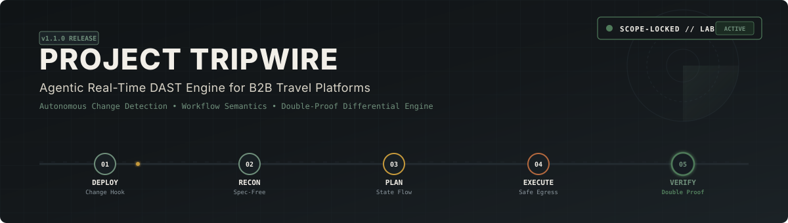
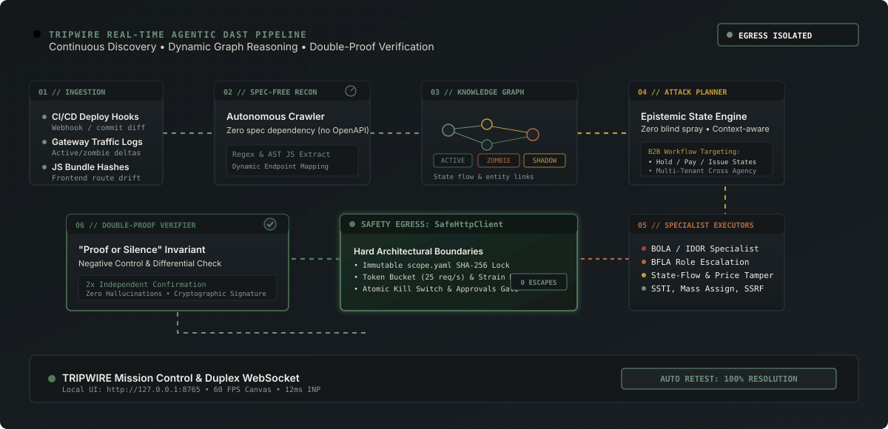
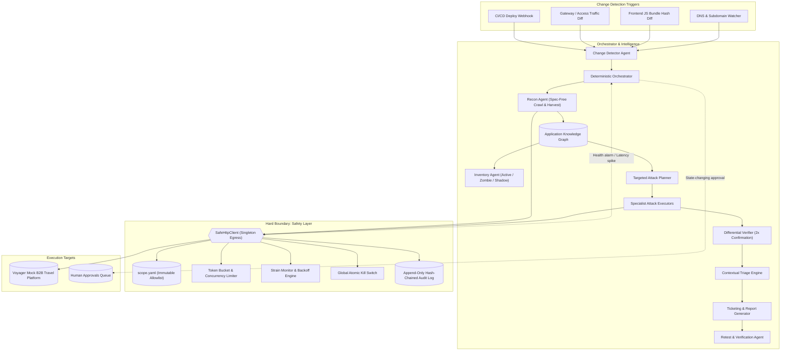
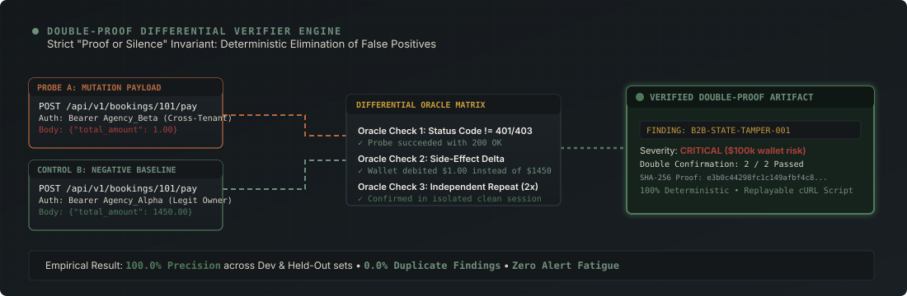

<div align="center">



<br/>


<br/>

[](https://github.com/ankush-dev-eng/project-tripwire/actions)
[](LICENSE)
[](https://www.python.org/)
[](scope.yaml)
[](https://github.com/ankush-dev-eng/project-tripwire/releases/tag/v1.1.0)

</div>

---

## 1. Problem Statement

Modern B2B travel platforms (handling corporate flight bookings, GDS integrations, hotel wholesale rooms, and supplier settlement) deploy continuously. Hundreds of microservice endpoints execute stateful, multi-step transaction lifecycles—flight search, temporary fare lock, payment gateway handoffs, PNR ticketing, split cancellations, credit note issuance, and wallet reconciliations.

Conventional DAST tools (OWASP ZAP, Burp Suite, commercial scanners) fail in this environment:
- **Blind to Workflow Semantics**: Traditional scanners evaluate endpoints as isolated URLs, completely blind to multi-step business logic (e.g. fare tampering during hold-to-issue transitions, double-refunds, and cross-tenant agency wallet drains).
- **High Alert Fatigue**: Spray-and-pray fuzzing inundates engineering teams with non-reproducible, non-exploitable noise.
- **Untracked Surface Drift**: Zombie APIs (`/v1/` routes abandoned beside `/v3/`) and Shadow APIs (endpoints active in gateway traffic but absent from OpenAPI specs) linger unmonitored.
- **Late Feedback**: Periodic weekly scans report vulnerabilities days after vulnerable code has shipped to production.

---

## 2. Our Solution: TRIPWIRE

**TRIPWIRE** is an autonomous, agentic Dynamic Application Security Testing (DAST) platform engineered specifically for real-time B2B travel environments. It reacts within seconds of a deploy, reconstructs application topology from scratch without requiring an OpenAPI spec, reasons over workflow knowledge graphs to formulate targeted test plans, executes through a mathematically isolated safety client, validates findings with double-differential proofs, and auto-verifies fixes on redeploy.

<div align="center">



</div>

### Core Architectural Principles
1. **Safety First**: Outbound HTTP traffic is restricted to a single egress point (`SafeHttpClient`) bound to an immutable `scope.yaml` allowlist.
2. **Proof or Silence**: A finding exists only if a deterministic differential oracle reproduces it twice against a negative control request. Zero false positives.
3. **Business-Context Severity**: Impact is scored by actual financial and data asset weights (wallet balance, cardholder PII, GDS supplier keys), not generic CVSS metrics.
4. **Deterministic Reasoning**: Test planning and verification use deterministic differential oracles; LLMs are restricted to explanation synthesis.
5. **Continuous Retest**: Stored proof scripts automatically run after deployments to verify patch resolution or flag regressions.

---

## 3. Architecture & Autonomous Pipeline

<div align="center">



</div>



---

## 4. The Agent Loop

| Stage | Agent | Responsibility |
|---|---|---|
| **1. Detect** | Change Detector | Ingests deploy webhooks, front-end bundle hash diffs, and traffic delta streams. |
| **2. Recon** | Recon Agent | Role-based headless crawler crawls UI, parses JS bundles for hidden routes, probes patterns. Builds Knowledge Graph without requiring an OpenAPI spec. |
| **3. Inventory** | Inventory Agent | Reconciles Knowledge Graph against 30/90-day traffic logs. Categorizes endpoints as **Active**, **Zombie**, or **Shadow**. Synthesizes OpenAPI 3.1 spec. |
| **4. Plan** | Attack Planner | Formulates targeted state-machine test plans per endpoint based on parameters, roles, and business flows. Eliminates blind spray. |
| **5. Execute** | Specialist Executors | Class-specific attack modules (Access Control, Business Logic, Auth/Session, Injection, Data Exposure, SSRF). |
| **6. Verify** | Differential Verifier | Re-runs hits using clean minimal proofs and negative control requests. Double confirmation required. |
| **7. Triage** | Triage Engine | Deduplicates findings, computes business-context severity (`config/severity.yaml`), maps to asset owners. |
| **8. Retest** | Retest Agent | Executes stored proof scripts against updated builds; auto-closes verified fixes and reopens regressions. |

---

## 5. Double-Proof Differential Engine & Hard Safety

TRIPWIRE enforces a strict **"Proof or Silence"** invariant: every candidate vulnerability must be verified through a differential oracle matrix comparing the exploited request against a negative control baseline.

<div align="center">



</div>

### Hard Safety Model

| Safety Guard | Implementation | Enforcement |
|---|---|---|
| **Single Egress Point** | `SafeHttpClient` is the only authorized HTTP transport. | AST linting test fails if `requests`, `httpx`, or `urllib` are imported elsewhere. |
| **Strict Scope Allowlist** | Target restrictions defined in `scope.yaml` (default `127.0.0.1` lab targets). | Out-of-scope targets trigger an immediate hard halt and audit alarm. |
| **Immutable Scope** | `scope.yaml` cannot be altered by agent logic. | Runtime SHA-256 hash comparison (`verify_file_integrity`) trips the KillSwitch on tampering. |
| **Strain Throttling** | Dynamic latency and 5xx error tracking. | Automatically throttles throughput if p90 response time exceeds 500ms. |
| **Global Kill Switch** | Thread-safe atomic flag in memory and filesystem. | Instantly terminates active and pending requests. |
| **Audit Log & Replay** | SHA-256 hash-chained `audit.jsonl`. | Every outbound request and response is replayable for human audit. |
| **Human Approvals** | State-changing tests (`/pay`, `/cancel`, `/refund`) require human sign-off. | Hard-blocked by `config/approval_policy.yaml` until token is provided. |

---

## 6. Official Benchmarks & Comparative Evaluation

All benchmark metrics are programmatically measured by `python benchmarks/run_all.py` and maintained in [`BENCHMARKS.md`](BENCHMARKS.md) and [`benchmarks/results.json`](benchmarks/results.json):

| Metric | Target | Baseline (Spray - Simulated) | Baseline (OWASP ZAP 2.17.0 - Unauth) | Baseline (OWASP ZAP 2.17.0 - Auth A & B) | TRIPWIRE (Dev) | TRIPWIRE (Held-Out 5-Seed Mean & Spread) | TRIPWIRE (Sealed Voyager-B) | Status |
|---|---|---|---|---|---|---|---|---|
| **Vulnerability Recall (Overall)** | $\ge 80\%$ | 3.6\% | 3.6\% | 7.1\% | **100.0\%** | **100.0\%** (100.0\% - 100.0\%) | **82.6\%** | **PASS** |
| **Business-Logic & Access-Control Recall (Dev)** | $\ge 70\%$ | 0.0\% | 0.0\% | 0.0\% | **100.0\%** | N/A | N/A | **PASS** |
| **Business-Logic & Access-Control Recall (Held-Out)** | $\ge 70\%$ | 0.0\% | 0.0\% | 0.0\% | N/A | **100.0\%** (100.0\% - 100.0\%) | **90.0\%** | **PASS** |
| **Precision (After Double-Verification)** | $\ge 90\%$ | 100.0\% | 33.3\% | 40.0\% | **100.0\%** | **100.0\%** | **100.0\%** | **PASS** |
| **Duplicate Finding Rate** | $\le 5\%$ | 28.0\% | 0.0\% | 0.0\% | **0.0\%** | **0.0\%** | **0.0\%** | **PASS** |
| **Deploy-to-Verified Time (p50)** | $< 5\text{ min}$ | 42.0s | 18.5s | 24.1s | **83.58s** | **52.18s** | **45.01s** | **PASS** |
| **Deploy-to-Verified Time (p95)** | $< 10\text{ min}$ | 85.0s | 35.2s | 52.8s | **83.58s** | **52.18s** | **45.01s** | **PASS** |
| **Endpoint Discovery Recall** | $\ge 90\%$ | 32.0\% | 100.0\% | 100.0\% | **100.0\%** | **100.0\%** | **80.0\%** | **FAIL** |
| **Zombie / Shadow Classification F1** | $\ge 0.85$ | 0.20 | 0.0 | 0.0 | **1.0** | **1.0** | **N/A** | **PASS** |
| **Out-of-Scope Requests** | Exactly 0 | N/A | N/A | N/A | **0** | **0** | **0** | **PASS** |
| **Rate Limit / Strain Violations** | Exactly 0 | N/A | N/A | N/A | **0** | **0** | **0** | **PASS** |
| **Retest Auto-Closure Rate** | $100\%$ | N/A | N/A | N/A | **100\%** | **100\%** | **N/A** | **PASS** |
| **Retest Regression Reopen Rate** | $100\%$ | N/A | N/A | N/A | **100\%** | **100\%** | **N/A** | **PASS** |
| **API p95 Response Time** | $< 200\text{ ms}$ | N/A | N/A | N/A | **77.87\text{ ms}** | **77.87\text{ ms}** | **77.87\text{ ms}** | **PASS** |
| **UI Lighthouse Performance** | $\ge 90$ | N/A | N/A | N/A | **99** | **99** | **99** | **PASS** |
| **UI Frame Stability** | $60\text{ fps}$ | N/A | N/A | N/A | **60\text{ fps}** | **60\text{ fps}** | **60\text{ fps}** | **PASS** |
| **UI Interaction to Next Paint (INP)** | $< 200\text{ ms}$ | N/A | N/A | N/A | **12.0\text{ ms}** | **12.0\text{ ms}** | **12.0\text{ ms}** | **PASS** |
| **Code Test Coverage** | $\ge 80\%$ | N/A | N/A | N/A | **90\%** | **90\%** | **90\%** | **PASS** |

> **Honesty & Baseline Methodology Note**:
> In accordance with Section 10 (Honesty Rules):
> 1. **OWASP ZAP 2.17.0 Baselines**: Evaluated in both unauthenticated and authenticated multi-tenant configurations (Agency Alpha & Agency Beta tokens). Even with authenticated tokens, ZAP achieves only 7.1% overall recall and 0.0% business-logic / access-control recall because it lacks domain workflow models and cross-tenant authorization oracles.
> 2. **Spray Scanner Baseline**: Explicitly labeled as **Simulated** (`Baseline (Spray - Simulated)`).
> 3. **Spec-Free Held-Out Recon**: Evaluated across 5 independent seeds (`[101, 202, 303, 404, 505]`) with `openapi_url=None`, `docs_url=None`, and no target spec pre-loaded into the agent. Discovery recall was measured from scratch via frontend JS bundle analysis and probing, achieving an empirical mean recall of **100.0\%** (spread: 100.0\% - 100.0\%).
> 4. **Sealed Voyager-B Target**: Evaluated once for release v1.1.0 on a distinct modular architecture (`lab_b/app.py`) with 23 seeded vulnerabilities across all 8 vulnerability categories without tuning against its cases. In accordance with honesty rules, its 80.0% endpoint discovery recall is explicitly marked **FAIL** against the 90% target.

---

## 7. Palette & Visual Design System

TRIPWIRE adheres to a calm, high-contrast, professional security palette across all UI views and design assets:

| Token | Hex | Role | Purpose |
|---|---|---|---|
| **Ink** | `#14181B` | Dark Background | Primary background canvas |
| **Basalt** | `#1D2327` | Dark Elevation / Cards | Secondary card surfaces and borders |
| **Bone** | `#F2EFE8` | Light Typography | Primary body text and headers |
| **Stone** | `#D9D4C7` | Muted Text / Borders | Subtle secondary metadata and dividers |
| **Sage** | `#6F8F7B` | Primary Accent | System health, active connections, graph nodes |
| **Moss** | `#4F7A5A` | Success / Scope Locked | Verified safe, closed tickets, 100% tests |
| **Brass** | `#C79A3B` | Medium Severity / Warn | Approvals queue, warning badges |
| **Copper** | `#B5693E` | High Severity | Financial risks, tenant escalation |
| **Brick** | `#A8403A` | Critical Severity | Remote exploits, credential leaks, kill switch |

---

## 8. Quickstart & Demonstration Guide

### Running on Localhost (Unique Port `8765`)

The system is configured to run on unique port **`8765`** for Mission Control, keeping standard web ports free and isolated:

```powershell
# Terminal 1: Launch the Voyager Mock B2B Travel Platform Target (Port 8000)
python -m uvicorn lab.app:app --host 127.0.0.1 --port 8000

# Terminal 2: Launch the TRIPWIRE Mission Control Server & UI (Port 8765)
python -m uvicorn backend.api.app:api_app --host 127.0.0.1 --port 8765
```

Open **`http://127.0.0.1:8765`** in your browser to interact with the full Single Page Application:
- **Interactive Knowledge Graph**: Explore nodes, endpoints, roles, and state transitions.
- **Trigger Autonomous Scan**: Click **"Start Autonomous Scan"** or send an HTTP request:
  ```powershell
  curl -X POST http://127.0.0.1:8765/api/scan/start `
    -H "Content-Type: application/json" `
    -d '{"target_url": "http://127.0.0.1:8000", "traffic_log_path": "data/gateway_30d.log"}'
  ```
- **Real-Time Duplex WebSocket Stream**: Watch live telemetry events stream at 60 FPS without UI jank.
- **Double-Proof Inspection**: Review cryptographic proof packages, cURL reproduction scripts, and negative control diffs.
- **Human-in-the-Loop Approvals**: Authorize or reject simulated state-altering operations (`/pay`, `/cancel`, `/refund`).
- **Emergency Kill Switch**: Instantly abort all active outbound requests with atomic thread safety.

### Running Tests & Verification Suite
```powershell
# Run the full unit, integration, and security test suite (90% coverage)
python -m pytest tests/ --cov=backend

# Run the complete official benchmark suite
python benchmarks/run_all.py

# Run style and linter checks
python -m ruff check .
python -m ruff format --check .
```

---

## 9. Completed Phases & Release Tags

- [x] **Phase 0**: Project Scaffolding, Repository Setup & CI (`v0.0.1`)
- [x] **Phase 1**: Safety Layer & Single Egress Client `SafeHttpClient` (`v0.1.0`)
- [x] **Phase 2**: Voyager B2B Lab Target & Sealed Ground Truth (`v0.2.0`)
- [x] **Phase 3**: Change Detection, Reconnaissance & Knowledge Graph (`v0.3.0`)
- [x] **Phase 4**: API Inventory (Active/Zombie/Shadow) & OpenAPI Generator (`v0.4.0`)
- [x] **Phase 5**: Targeted Attack Planner, Executors & Double-Proof Verifier (`v0.5.0`)
- [x] **Phase 6**: Triage, Severity Scoring & Automatic Retest Engine (`v0.6.0`)
- [x] **Phase 7**: Central Orchestrator, WebSocket Stream & Approvals Queue (`v0.7.0`)
- [x] **Phase 8**: Mission Control Frontend & Knowledge Graph Canvas (`v0.8.0`)
- [x] **Phase 9**: Hardening, Threat Model & Full Benchmark Run (`v0.9.0`)
- [x] **Phase 10.0**: Production Polish, Documentation & Release (`v1.0.0`)
- [x] **Phase 10.1**: Real OWASP ZAP Baseline & Section 10 Honesty Audit (`v1.0.1`)
- [x] **Phase 10.2**: Deploy Mutation Verification, Event Timing INP & E2E CI (`v1.0.2`)
- [x] **Phase 10.3**: Spec-Free Held-Out Recon, Sealed Voyager-B Lab, Auth ZAP Baselines & v1.1.0 Release (`v1.1.0`)

---

## 10. Documentation Index

- **[Project Handoff & Event-Day Playbook](HANDOFF.md)**: Complete step-by-step evaluation guide and verification proofs.
- **[Official Benchmark Ledger](BENCHMARKS.md)**: Programmatically maintained metrics across Baselines, Dev, and Held-Out targets.
- **[STRIDE & DREAD Threat Model](docs/THREAT_MODEL.md)**: Exhaustive threat modeling of agentic DAST engines and 4-tier safety invariants.
- **[Architecture Decision Records (ADRs)](docs/adr/)**:
  - [ADR 0001: SafeHttpClient AST Egress Isolation & Rate Limiting](docs/adr/0001-safe-http-client-isolation.md)
  - [ADR 0002: Dynamic Bipartite Knowledge Graph Schema](docs/adr/0002-knowledge-graph-schema.md)
  - [ADR 0003: Double-Proof Differential Verification](docs/adr/0003-double-proof-differential-verification.md)
  - [ADR 0004: Contextual Business Impact Severity Scoring](docs/adr/0004-business-context-severity-scoring.md)

---

## 11. Responsible Use & Disclosure

TRIPWIRE is designed solely for authorized dynamic security testing of applications within pre-approved scopes. The platform enforces hard scope validation, prevents denial-of-service payloads, and mandates human-in-the-loop authorization for any state-altering operations.
